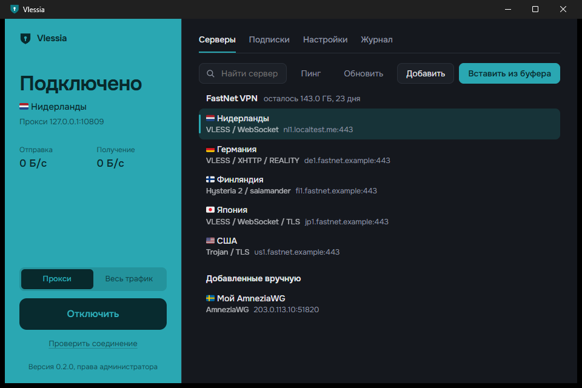

# Vlessia

VPN-клиент на Xray-core для Windows, macOS, Linux и Android: VLESS, VMess,
Trojan, Shadowsocks, Hysteria 2, AmneziaWG, WireGuard, OpenVPN.

[Скачать последнюю версию](https://github.com/feds1337/vlessia/releases/latest) · [Лицензия](LICENSE)



## Возможности

- Два режима: системный прокси и «весь трафик» (TUN-адаптер).
- Подписки: остаток трафика, срок действия, анонсы, автообновление и напоминания.
- Автопереподключение: сторож соединения, смена сети, пробуждение, переход на самый быстрый сервер.
- Kill switch, цепочка через второй сервер, балансировка между серверами подписки.
- Правила для сайтов, IP и приложений; на Android — раздельный туннель по приложениям.
- Автозапуск, автообновление, русский и английский интерфейс.

## Протоколы

| Протокол | Как добавить |
|---|---|
| VLESS — REALITY, XTLS Vision, TCP/WS/gRPC/XHTTP/HTTPUpgrade | `vless://`, подписка |
| VMess, Trojan | `vmess://`, `trojan://` |
| Shadowsocks, Outline | `ss://`, `ssconf://` |
| Hysteria 2 — salamander, port hopping, Brutal | `hysteria2://`, `hy2://` |
| AmneziaWG 1.0–3.1 | `.conf`, `vpn://` |
| WireGuard | `.conf`, `wireguard://` |
| OpenVPN — tls-auth/crypt, UDP и TCP | `.ovpn` |
| SOCKS5, HTTP(S) | `socks://`, `http://host:port` |

## Установка

Файлы для всех систем — на [странице релиза](https://github.com/feds1337/vlessia/releases/latest).

| Система | Файл |
|---|---|
| Windows 10/11 | `…-setup.exe`, без установки — `…-portable.exe` |
| macOS 11+, Intel и Apple Silicon | `…-macos-universal.dmg` |
| Ubuntu / Debian | `vlessia_…_amd64.deb` |
| Другие Linux (GTK 3, WebKitGTK 4.1) | `…-linux-amd64.tar.gz` |
| Android 7+ | `…-android-arm64-v8a.apk` или `…-universal.apk` |

Сборки не подписаны: Windows покажет SmartScreen — «Подробнее» → «Выполнить
в любом случае»; на macOS откройте приложение правой кнопкой → «Открыть», а если
система пишет, что оно повреждено, — `xattr -cr /Applications/Vlessia.app`.

Права администратора нужны только режиму «весь трафик»: создавать адаптер и менять
маршруты система разрешает лишь администратору. На macOS и Linux клиент при этом
остаётся обычной программой и запрашивает пароль для служебного процесса.

<details>
<summary>Ограничения</summary>

- Android работает только в режиме «весь трафик»: режима «Прокси» там нет. Пинг
  серверов идёт напрямую, в обход VPN.
- macOS: значка в строке меню нет — окно сворачивается в Dock, выход через
  «Vlessia → Выйти» (⌘Q).
- Linux: трей работает в окружениях с StatusNotifierItem (в GNOME нужно расширение
  AppIndicator); для «весь трафик» нужен `pkexec`.
- Плагины Shadowsocks (`?plugin=`) и маскировка Outline `prefix` не поддерживаются.
- AmneziaWG: параметры J1–J3 и Itime из версии 1.5 пропускаются.
- OpenVPN: без сжатия, CBC-шифров, `dev tap` и статических ключей — нужен
  tls-auth / tls-crypt.
- WireGuard, AmneziaWG и OpenVPN по UDP не отвечают на пинг — проверяйте подключением.

</details>

## Сборка

Go 1.27+, [Wails](https://wails.io) v2; для Android — gomobile и NDK.

```bash
wails build -clean -trimpath -ldflags "-s -w"
```

Устройство клиента, тесты и выпуск релизов — в [docs/DEVELOPMENT.md](docs/DEVELOPMENT.md).

## Лицензия

[AGPL-3.0](LICENSE). Для личного использования ограничений нет; при распространении
изменённого клиента или предоставлении его как сервиса нужно открыть исходный код —
этого требует встроенный go-openvpn.

Используется: [Xray-core](https://github.com/XTLS/Xray-core) (MPL-2.0),
[amneziawg-go](https://github.com/amnezia-vpn/amneziawg-go) (MIT),
[go-openvpn](https://github.com/n0madic/go-openvpn) (AGPL-3.0),
[Wails](https://wails.io) (MIT), Wintun (© WireGuard LLC,
[лицензия](internal/tun/wintun-LICENSE.txt)), шрифт Onest (SIL OFL 1.1),
флаги Twemoji (CC-BY 4.0).
