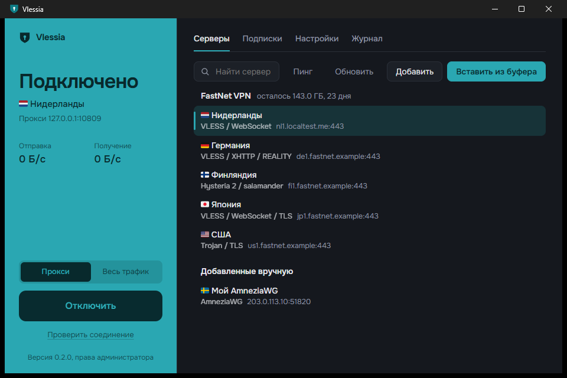
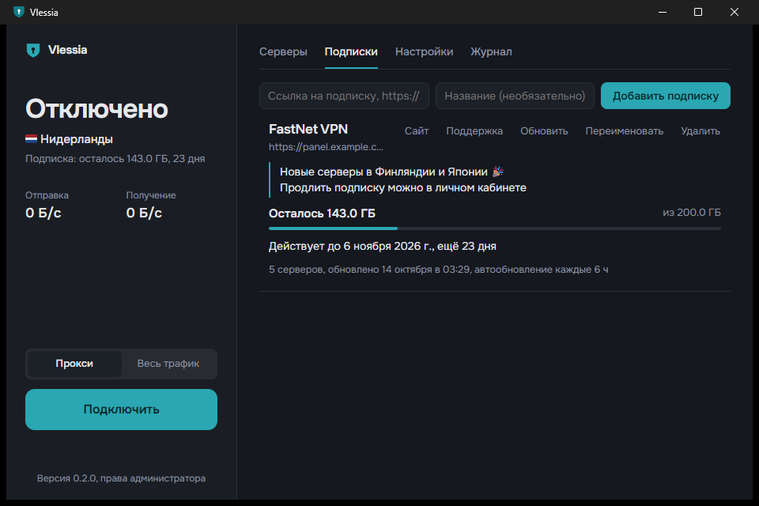
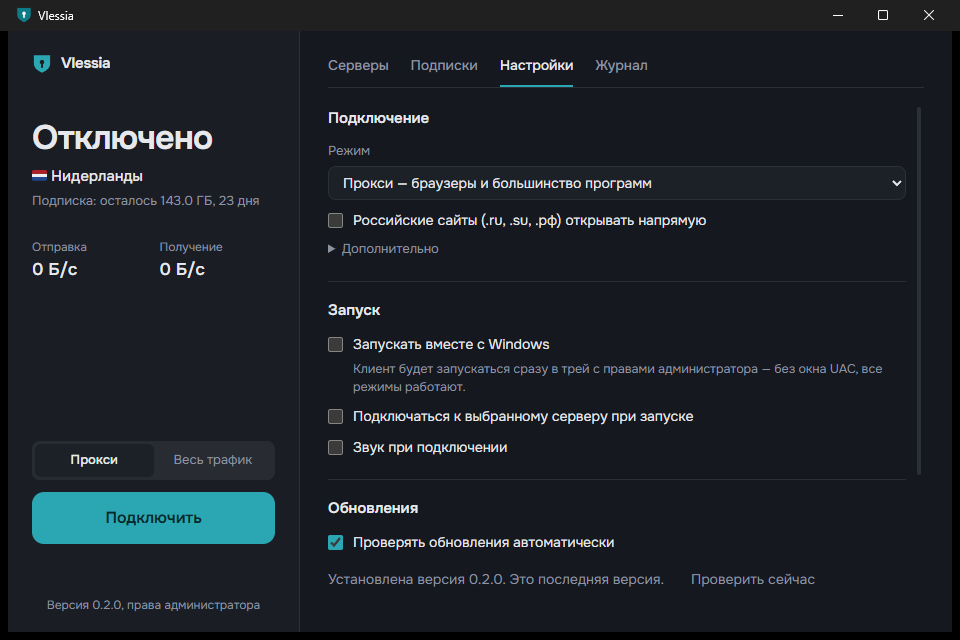

<div align="center">


# Vlessia

**Быстрый и красивый VPN-клиент для Windows на базе Xray-core**

VLESS · Hysteria 2 · AmneziaWG · WireGuard · OpenVPN · Outline — в одном окне и одном `.exe`

[](https://github.com/feds1337/vlessia/releases/latest)
[](https://github.com/feds1337/vlessia/releases)
[](#-установка)
[](LICENSE)

### [⬇️ Скачать последнюю версию](https://github.com/feds1337/vlessia/releases/latest)



</div>

---

## ✨ Почему Vlessia

<table>
<tr>
<td width="50%" valign="top">

### 🚀 Один клик — и вы в сети
Скопировали ссылку или подписку → «Вставить из буфера» → большая кнопка. Всё.

### 🛡️ Два режима
**Прокси** — без прав администратора, для браузеров и большинства программ.
**Весь трафик** — вся система через VPN, включая игры и консольные утилиты.

### 📦 Подписки как надо
Остаток гигабайт, срок действия, анонсы провайдера, ссылки на поддержку, автообновление.

</td>
<td width="50%" valign="top">

### 🧩 Почти любые протоколы
От VLESS REALITY до AmneziaWG 3.1 и OpenVPN — без установки сторонних программ.

### 🏁 Запуск вместе с Windows
Автозапуск сразу в трей и автоподключение — даже в режиме «Весь трафик», без окна UAC.

### 🔄 Обновляется сам
Находит новую версию на GitHub, проверяет контрольную сумму и ставит её в один клик.

### 🎨 Приятные мелочи
Флаги стран, пинг серверов, скорость в реальном времени, светлая и тёмная тема вслед за Windows, значок в трее. И звук при подключении 💨 — включается в настройках.

</td>
</tr>
</table>

<div align="center">


</div>

## 🔌 Протоколы

| Протокол | Как добавить | Что поддерживается |
|---|---|---|
| **VLESS** | `vless://`, подписка | REALITY, XTLS Vision, TCP · WS · gRPC · XHTTP · HTTPUpgrade, VLESS-encryption |
| **VMess · Trojan** | `vmess://`, `trojan://` | TLS, все транспорты Xray |
| **Shadowsocks · Outline** | `ss://`, `ssconf://` | SIP002 и старый формат, динамические ключи Outline |
| **Hysteria 2** | `hysteria2://`, `hy2://` | salamander, port hopping, Brutal, самоподписанные сертификаты |
| **AmneziaWG** | `.conf`, `vpn://` из AmneziaVPN | версии 1.0 – 3.1, включая `HeaderProtectionKey` и `RandomTrailers` |
| **WireGuard** | `.conf`, `wireguard://` | ссылки форматов v2rayN, sing-box, Hiddify |
| **OpenVPN** | `.ovpn` | tls-auth / tls-crypt / tls-crypt-v2, UDP и TCP, логин и пароль |
| **SOCKS5 · HTTP(S)** | `socks://`, `http://хост:порт` | с логином и паролем |

## 📥 Установка

1. Скачайте **`Vlessia-…-setup.exe`** со страницы [Releases](https://github.com/feds1337/vlessia/releases/latest) и запустите.
2. Скопируйте ссылку на сервер или подписку от провайдера и нажмите **«Вставить из буфера»**.
3. Нажмите большую кнопку подключения. 🎉

> [!TIP]
> Не хотите устанавливать? Берите **`Vlessia-…-portable.exe`** — он работает без установки.

> [!NOTE]
> Установщик пока не подписан цифровой подписью, поэтому Windows SmartScreen может предупредить о «неизвестном издателе». Нажмите **«Подробнее» → «Выполнить в любом случае»**.

## ❓ Вопросы и ответы

<details>
<summary><b>«Прокси» или «Весь трафик» — что выбрать?</b></summary>

**Прокси** подходит для браузеров, мессенджеров и большинства программ и не требует прав администратора. **Весь трафик** создаёт виртуальный сетевой адаптер (TUN) и заворачивает в VPN вообще всё — игры, торренты, консольные утилиты. WireGuard, AmneziaWG и OpenVPN всегда работают в этом режиме.
</details>

<details>
<summary><b>Почему клиент просит права администратора?</b></summary>

Только для режима «Весь трафик»: создавать сетевые адаптеры и менять маршруты Windows разрешает лишь администратору. Клиент сам предложит перезапуститься с нужными правами. Режиму «Прокси» права не нужны.
</details>

<details>
<summary><b>Как сделать, чтобы VPN включался сам при входе в Windows?</b></summary>

Запустите Vlessia от имени администратора, откройте **Настройки → Запуск** и включите «Запускать вместе с Windows» и «Подключаться при запуске». Клиент будет стартовать сразу в трей с правами администратора и без окна UAC, так что заработает и режим «Весь трафик».
</details>

<details>
<summary><b>Как обновить клиент?</b></summary>

Ничего делать не нужно: клиент проверяет GitHub после запуска и раз в 6 часов. Когда выходит новая версия, в левой колонке появляется «Доступна версия…» — нажмите «Обновить». Клиент скачает установщик, сверит контрольную сумму, обновится и перезапустится, а если VPN был включён — подключится снова. Автопроверку можно выключить в настройках. Portable-версия вместо этого откроет страницу релиза.
</details>

<details>
<summary><b>Подписка не показывает остаток трафика</b></summary>

Клиент берёт эти данные из ответа сервера подписки (`subscription-userinfo` и другие заголовки, а также служебные строки в теле подписки). Если провайдер их не присылает, показать нечего — карточка подписки так и напишет.
</details>

<details>
<summary><b>Где хранятся мои серверы и как всё удалить?</b></summary>

Настройки, серверы и логи лежат в `%APPDATA%\Vlessia` (кнопка «Открыть папку данных» в настройках). Удаляется клиент через «Параметры → Приложения»: установщик уберёт автозапуск и вернёт системный прокси, а ваши серверы оставит на случай переустановки.
</details>

<details>
<summary><b>Известные ограничения</b></summary>

- Только Windows 10 / 11 (x64).
- Параметр `allowInsecure` в Xray удалён (с 01.06.2026); вместо него поддерживаются `pcs` (pinnedPeerCertSha256) и `vcn` (verifyPeerCertByName). Для Hysteria 2 с `insecure=1` сертификат закрепляется автоматически.
- Плагины Shadowsocks (`?plugin=`) не поддерживаются; маскировка Outline `prefix` тоже (подключение работает без неё).
- AmneziaWG: параметры J1–J3 и Itime из промежуточной версии 1.5 пропускаются. Из ссылок `vpn://` импортируются только контейнеры AWG / WireGuard.
- OpenVPN: не поддерживаются сжатие (`comp-lzo`, `compress`), шифры CBC, `dev tap`, статические ключи и профили без tls-auth / tls-crypt — клиент сообщит об этом при импорте.
- WireGuard, AmneziaWG и OpenVPN по UDP не отвечают на пинг — проверяйте их подключением.
</details>

## 🛠️ Для разработчиков

Vlessia написан на Go: [Xray-core](https://github.com/XTLS/Xray-core) встроен как библиотека, интерфейс на [Wails](https://wails.io) (WebView2). Сборка, тесты, выпуск релизов и устройство клиента — в **[docs/DEVELOPMENT.md](docs/DEVELOPMENT.md)**.

```bash
wails build -clean -trimpath -ldflags "-s -w" -nsis
```

## 💚 Благодарности

- [Xray-core](https://github.com/XTLS/Xray-core) — сердце клиента (MPL-2.0)
- [amneziawg-go](https://github.com/amnezia-vpn/amneziawg-go) — AmneziaWG и WireGuard (MIT)
- [go-openvpn](https://github.com/n0madic/go-openvpn) — OpenVPN (AGPL-3.0)
- [Wails](https://wails.io) — десктопная оболочка (MIT)
- [Wintun](https://www.wintun.net/) — драйвер TUN, © WireGuard LLC, распространяется по [лицензии Prebuilt Binaries](internal/tun/wintun-LICENSE.txt) и используется только через штатный API
- [Onest](https://github.com/simpals/onest) — шрифт интерфейса (SIL OFL 1.1, текст в `frontend/dist/fonts/Onest-LICENSE.txt`)
- [Twemoji Country Flags](https://github.com/talkjs/country-flag-emoji-polyfill) — флаги (MIT; изображения [Twemoji](https://github.com/twitter/twemoji), © Twitter, Inc. и др., [CC-BY 4.0](https://creativecommons.org/licenses/by/4.0/), полный текст в `frontend/dist/fonts/`)

## 📄 Лицензия

[AGPL-3.0](LICENSE). Для личного использования ограничений нет. Если распространяете изменённый клиент или предоставляете его как сервис, нужно открыть исходный код — этого требует встроенный go-openvpn.
